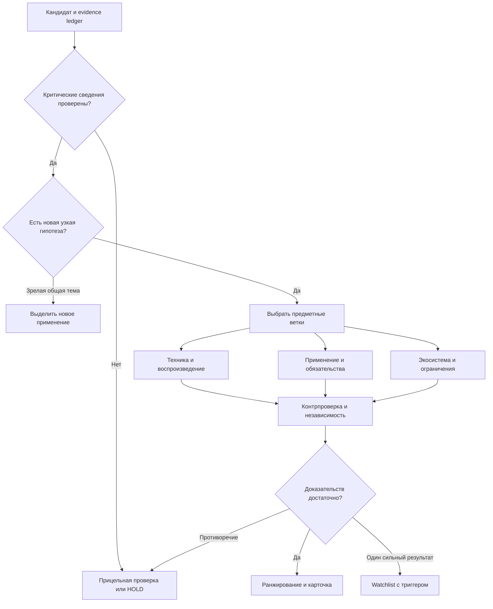

# Методология для переноса в METHODOLOGY.md

Ниже — дословно сохранённые предметные разделы v6.1. Полная версия — baseline/v6_1. Новая архитектура может менять инструменты, но изменение методики требует явного решения и проверки.

Интеграционные уточнения 21.09:

- `normalized_growth` — общий helper равнодлинных окон; он не жёстко требует 90 дней. В продуктовой конфигурации зафиксировать именно два завершённых непересекающихся 90-дневных окна, их cutoff, включительность дат, запрос и coverage. Несопоставимость даёт null с причиной.
- `route` — пример: порядок отдельных проверок отличается от текстовой стадии §6 (countersearch проверяется до branches_complete). Согласовать и покрыть сценариями зависимости в исполняемом routing; не объявлять полное соответствие одной копией функции.
- Не придумывать ограничение origins <= events без модели происхождения. Агрегаты получать из связанных ledger-объектов, не из произвольных чисел LLM.
- Порог 3 события/2 группы — версионированная эвристика, не научная универсальная константа. Сильный одиночный результат сохраняется отдельно.

## 4. Что удалось извлечь из всех 100 строк

### 4.1. Структура и ограничения

Таблица состоит из шести AI-ориентированных направлений: Edge и защита ИИ — по 16 записей; индустриальный ИИ, инфраструктура ИИ, роботы и финтех — по 17. Это относительно равномерно составленная подборка, а не случайная выборка мировой технологической активности.

Оценки: 7 — 15 строк, 6 — 28, 5 — 28, 4 — 22, 3 — 7. Таблица упорядочена по оценке. **ID, порядок строки, готовая оценка, словесная динамика и объяснение «почему слабый» нельзя использовать как независимые признаки для честного предсказания этой же оценки.** Это прямой риск утечки ответа.

В файле нет репрезентативного набора отрицательных примеров, исходных временных рядов или полностью определённого целевого класса. Поле «растёт» — утверждение составителя. Оно не заменяет динамику публикаций, патентов или использования.

### 4.2. Каталог из 18 механизмов

В `data/pattern_registry.json` определены механизмы, необходимые доказательства, контраргументы и ветки. В `data/dataset_patterns_100.csv` и JSON — привязка к каждой исходной строке.

| Код | Механизм | Характерные номера XLSX |
|---|---|---|
| P01 | Новый технический механизм | 49, 85, 89, 95, 97 |
| P02 | Порог эффективности, стоимости или ресурсов | 1, 7, 57, 84, 96 |
| P03 | Переход от опыта к применению | 17, 37, 81, 90 |
| P04 | Сближение раннего капитала | 2, 44, 61, 66 |
| P05 | Новый самостоятельный продуктовый слой | 2, 11, 36, 46, 75 |
| P06 | Новое применение зрелой технологии | 19, 43, 45, 72, 94 |
| P07 | Узкое место и дополняющая инфраструктура | 10, 13, 14, 34, 83 |
| P08 | Стандарт, совместимость, новые интерфейсы | 50, 51, 67, 69 |
| P09 | Новая угроза или нормативный стимул | 4, 15, 22, 76, 100 |
| P10 | Перенос вычислений и границ данных | 18, 24, 35, 82, 96 |
| P11 | Независимое исследовательское сближение | 76, 92, 97, 98 |
| P12 | Формирование экосистемы разработчиков | 45, 51, 69, 78, 88 |
| P13 | Разрыв между предметным прогрессом и вниманием | 89; общий мотив встречается шире |
| P14 | Новая модель транзакции, оплаты или риска | 14, 62, 67, 70 |
| P15 | Обязательство пользователя или внедренца | 12, 27, 31, 54, 71 |
| P16 | Соединение ранее раздельных технологий | 28, 63, 78, 79, 98 |
| P17 | Возвращение ранее неудавшегося направления | 8, 44, 84, 87 |
| P18 | Грант или публичная исследовательская программа | 55, 80 |

При выборе **главного** механизма каждой строки: новое применение зрелой технологии — **20**, новая угроза/нормативный стимул — **13**, самостоятельный продуктовый слой — **12**, порог эффективности — **10**. В совокупности это 55 из 100 записей нашей разметки. Этот результат объясняет, почему один детектор роста упоминаний не воспроизведёт полезную логику датасета.

Подсчёт относится к предложенной аналитической классификации, не является оценкой долей мирового рынка и не претендует на единственно возможную разметку. Вторичные метки многозначны. Например, P13 намеренно не проставлен всем строкам, где написано «почти не обсуждается»: слабое освещение само по себе не доказательство.

### 4.3. Иерархия, которую необходимо ввести

| Семейство | Строки | Что различать |
|---|---|---|
| Нейроморфные вычисления | 8, 45, 80 | Общий класс; включение в EDA; промышленный always-on сценарий |
| Аналоговый compute-in-memory | 44, 84 | Возрождение направления и показатели конкретных поставок |
| Орбитальный инференс | 18, 59 | Бортовое вычисление и более широкий проект орбитального ЦОД |
| Фотонное вычисление | 47, 60 | Ограниченный SWaP-сценарий и общий вычислительный класс |
| Федеративное обучение | 19, 43, 82 | Sovereign deployment, межбанковский AML, межзаводское применение |
| Инфраструктура агентов | 2, 50, 67, 69, 91 | Identity, полномочия, подпись трафика, оплата, settlement |
| Edge-оркестрация | 46, 56, 75 | Управление парком, распределённая сеть, маршрутизация отдельного запроса |

Это **кандидаты отношений**, не автоматические дубли. Две карточки можно сохранить, если различаются механизм, пользователь и доказанное изменение. Один и тот же раунд или прототип не должен повторно повышать их независимость. Разнообразие ТОП-15 достигается ограничением близких тем и объяснимой группировкой, а не удалением всех соседних применений.

### 4.4. Ошибки, которые наша система должна ловить

1. **№1:** смешаны размер раунда и оценка компании; отношение 570/215 само по себе не даёт «почти пятикратный рост оценки».
2. **№47 и №60:** для OLIX фигурируют $312M с разными месяцами — август и февраль. Нужен канонический event и первичный документ; не выбрать удобную дату автоматически.
3. **№12, №35, №59, №64:** план производства, будущее мероприятие, тесты 2027 и планируемый объём датасета нельзя учитывать как выполненные достижения на 17 сентября.
4. **№34:** контракт на питание ЦОД не делает реактор работающим. Финансовое обязательство и физическая готовность разделены.
5. **№43:** 10 млн синтетических транзакций в эксперименте не равны 10 млн реальных банковских операций.
6. **№76:** название обещает сертифицированную защиту, а объяснение описывает атаки и отсутствие зрелых защит. Выделяем подтверждённую угрозу и гипотезу решения отдельно.
7. **№85:** многие публикации об одном анонсе — одно исходное событие, а не широкое независимое подтверждение.
8. **№90:** «clinically ready», награда, доклинический результат и фактически проведённое испытание — разные стадии.
9. **№18 и №21:** разночтения сумм текста и slug ссылки — повод сверить страницу, но не основание считать slug истинным.
10. **№100:** новизна конкретной банковской миграции не равна новизне всей постквантовой криптографии.

Это найденные внутренние противоречия и задачи проверки. Там, где не прочитан первоисточник, документ не объявляет, какая сторона противоречия верна.

## 5. Как превращаем паттерны в сбор и обработку

### 5.1. Контракт паттерна

Каждое правило содержит `pattern_id`, применимые отрасли, механизм, примеры и контрпримеры, извлекаемые события, нужные поля, источники, проверки, критерий результата, следующий шаг, срок пересмотра и версию. Оно не является длинным промптом «найди что-нибудь интересное».

Например, **P17 Revival**:

- обнаружить прежний провал/закрытие и новый опыт, раунд или поставку;
- выяснить, какой прежний барьер изменился: yield, ADC/DAC overhead, стоимость, доступность данных, энергопотребление;
- если изменились только инвесторы и формулировки — не подтверждать техническое возрождение;
- если есть измеренный новый результат — отправить в PERFORMANCE и MATURITY;
- если критические сведения закрыты — HOLD с триггером «публикация benchmark/первые поставки».

### 5.2. Контракт отдельного утверждения

Минимальные поля: `claim_id`, `subject`, `predicate`, `object_or_value`, `unit`, `scope`, `kind`, `status`, `critical`, `evidence_for`, `evidence_against`, `event_id`, `origin_group_id`, `available_at`, `event_at`, `planned_for`, `fetched_at`, `valid_as_of`.

- `kind`: факт источника, заявление поставщика, аналитический вывод, гипотеза, прогноз.
- `status`: verified/supported/unknown/disputed/refuted. Достаточность подтверждения зависит от утверждения: пресс-релиз подтверждает, что компания заявила показатель; сам показатель может остаться `reported`.
- Сумма раунда, valuation, грант, revenue, контракт, мощность, отгрузки и будущая мощность — отдельные типы значений.
- Источник хранит snapshot/hash, URL, название, язык, фрагмент, его позиции и доступность. Ссылка без прочитанного фрагмента не делает claim проверенным.
- Дата публикации документа, дата события, дата первого наблюдения нами и плановая дата исполнения не сливаются. Нынешняя версия обновляемой страницы не доказывает, что текст был известен в прошлом.

### 5.3. Стадии

| Этап | Что выполняется | Обязательный выход |
|---|---|---|
| 0. Scope | Направление, временной срез, география, задача пользователя, бюджет | Версионированный research request |
| 1. Discovery | Расширение терминов, поиск первичных источников, сбор кандидатов | Список документов и причины находки |
| 2. Ingest | Snapshot, hash, метаданные, парсинг HTML/PDF/XLSX, язык | Document/chunk с provenance |
| 3. Normalize | Организации, технологии, родитель/подтема, DOI/arXiv/family/round IDs | Canonical entities и события |
| 4. Extract | Типизированные claims и связи с цитатами | Evidence ledger, конфликты, неизвестное |
| 5. Route | Выбор механизмов P01–P18; ранние проверки критических зависимостей | План релевантных веток |
| 6. Verify | Проверка механизма, эффективности, внедрения, капитала и иных нужных веток | Ответы на конкретные критические вопросы |
| 7. Countersearch | Старые аналоги, отрицательные результаты, зрелые решения, повторы | Аргументы за и против новизны |
| 8. Measure | Допустимые временные ряды и зарегистрированные переходы стадий | Feature snapshot с missingness/coverage |
| 9. Decide | Допуск, watchlist, HOLD, исключение или уточнение подтемы | Версионированное решение и основание |
| 10. Rank/report | ТОП до 15 подтверждённых ранних тем, отдельные новые наблюдения, применение банку | Карточки, граф, отчёт, журнал решения |
| 11. Monitor | Новые события, противоречия, истечение актуальности, re-entry trigger | Пересмотр карточки, история версий |

Материал из веба остаётся данными; содержащиеся в нём инструкции не меняют права инструментов, системные правила или схему анализа. Любая предлагаемая агентом новая стратегия становится кандидатом конфигурации, проходит проверку и получает новую версию. Runtime не устанавливает произвольные плагины из найденных страниц.

## 6. Разветвлённая логика

Не каждый кандидат проходит все ветки. Для лабораторной e-skin нет обязательного seed-раунда; для новой закупочной платформы arXiv не обязателен. Для каждого пропуска фиксируем: нерелевантно, уже подтверждено или отложено до конкретного решения.

**Приоритет переходов:** проверка доступности и критических опровержений → unresolved claims → зрелость → выбранные ветки → контрпроверка → допуск → ранжирование. Дедлайн не может превратить UNKNOWN в PASS или обойти подтверждённое опровержение. Отрицательное слабое сообщение сначала проверяется; оно не автоматически убивает направление.

Начальная политика допуска в основной список: конкретное новое содержание, ранняя стадия, минимум три самостоятельных события и две подтверждённые группы происхождения, выполненные критические проверки и подтверждённое изменение. **Это инженерная гипотеза допуска, а не научно установленная универсальная граница.** Меняем её только через версию и оценку результатов.

Единственный сильный новый результат обязательно сохраняется в **watchlist singleton**. Его нельзя потерять как шум HDBSCAN, но нельзя и назвать широким независимым трендом. Если подтверждено 9 подходящих тем, показываем 9 и причину; оставшиеся места не заполняем выдумками.

После двух поисковых волн без изменения критических сведений: сменить метод, уточнить гипотезу или HOLD с условием возврата. Не запускать бесконечное повторение похожих запросов. Прогрессом считается проверенное изменение существенного знания, включая опровержение, а не только первый PASS крупного критерия. Повторная доставка checkpoint не считается новой волной. Ожидание внешнего источника — `waiting_source` с timeout и бюджетом, а не доказательство застоя.

## 7. Что и как считаем

**Discovery corpus** и **measurement cohort** хранятся отдельно. Первый меняется при поиске; второй фиксирует запрос, источник, критерии включения, даты, полноту страниц и версию сборщика. Результаты top-k поиска подходят для discovery, но не для доли технологии во всей отрасли.

Для сопоставимого источника:

`p = (n + 0.5) / (N + 1)`;

`g = log2(p_recent / p_previous)`.

`n` — независимые события темы, `N` — события направления в том же корпусе. Сглаживание уменьшает проблему нуля, но не доказывает статистическую значимость. Показываем исходные n/N, оба периода, интервалы неопределённости и ограничения независимости. При большом числе одновременно проверяемых тем отдельно контролируем множественные сравнения; один высокий z-score не объявляем открытием.

Для первой реализации выбираем **два непересекающихся окна равной длительности по 90 завершённых дней**, заканчивающиеся до среза, плюс более длинный фон по доступности. Календарные месяцы и кварталы показываем отдельно. На 17 сентября Q3 ещё не завершён: возможен явно помеченный quarter-to-date при сопоставимом фоне, но не сравнение неполного Q3 с полным кварталом без поправки.

Если корпус неполон или протокол менялся, `growth = null` и причина видны. Не подставляем 0 и не нормализуем скрыто оставшиеся веса. Подлинно новое событие всё равно может быть полезно через качественную ветку перехода; для него не рисуем вымышленный численный рост.

**Технический выигрыш:** baseline, аппаратная конфигурация, датасет, precision/quality, latency/throughput/energy, весь системный контур, воспроизводимость. Показатели из разных условий не усредняются как сопоставимые.

**Капитал:** число независимых команд и закрытых событий; сравнение раундов отдельно от valuations. Размер денег — поддерживающий признак, не автоматический балл ранней стадии.

**Граф:** отдельные Document → Claim → Event → Technology/Application/Organization, а также `supports`, `contradicts`, `subtopic_of`, `implements`, `funded_by`, `announces`, `pilots`, `depends_on`. Подтверждённый поставщик и потенциально способный поставщик имеют разные отношения. Каждый значимый edge имеет источник и дату; similarity не превращается в факт сотрудничества.

**Ранжирование:** сначала gates, затем версионированная сортировка по доказанности нового содержания, подтверждённому изменению стадии/механизма, независимости, релевантности запросу и доступной динамике. Компоненты видимы. Для одинакового профиля допускаем экспериментальный emergence index, но не смешиваем качественный singleton и богатый библиометрический ряд в одну псевдовероятность. Opportunity/bank relevance остаётся отдельной осью.

