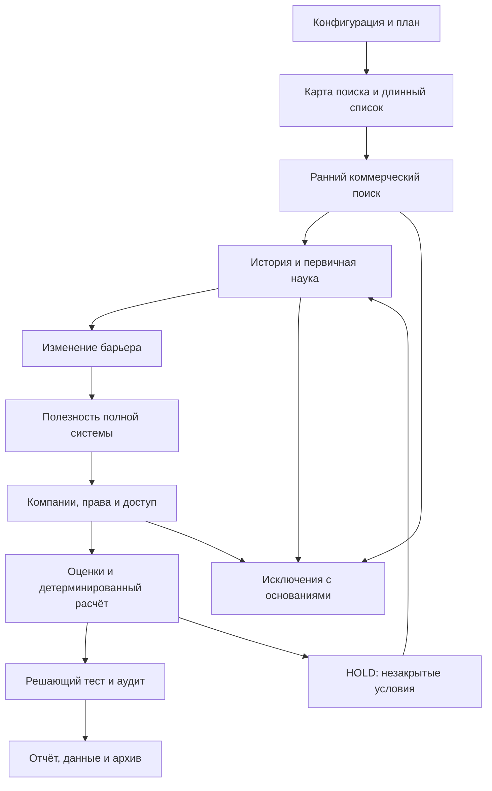

# Workflow: полный воспроизводимый цикл

Этот регламент описывает передаваемый процесс на основании исходной работы. Явные нормы регистрации данных ниже детализированы при упаковке для следующего агента. Они не означают, что все такие журналы были полностью сохранены в первом запуске.

## Режим и принцип исполнения

Выберите один режим: A — точный пересчёт, B — повторная оценка тех же свидетельств, C — независимое исследование. Не менять его молча. Для A используйте reproduce.py; следующий процесс нужен для B/C.

Результат этапа должен быть сохранён на диск до перехода дальше. Исходный research/ считать эталоном; новый запуск хранить отдельно. Нужны записи результата, источников и кратких оснований решений, а не непрерывная стенограмма рассуждений.

## Этап 0. Зафиксировать эксперимент

**Вход:** запрос пользователя и ограничения.
**Действия:** записать дату среза, тип потока, возраст, географию, допустимое финансирование, трактовку коммерческой занятости, язык и требуемое число исследовательских карточек.
**Выход:** run_config.json, PLAN.md и журнал допущений.
**Условие перехода:** нет скрытых определений, влияющих на исключение.

Для повторения версии 0.1: resurrection; 2026-09-29; минимум 10 лет; академические гранты разрешены; коммерчески освоенные реализации исключаются. При другом срезе считать это новым экспериментом.

## Этап 1. Сформировать карту поиска

**Вход:** концепция и ограничения.
**Действия:** искать старые процессы, неуспешные пилоты, отрицательные результаты и современные изменения материалов/производства. Для каждого направления собрать синонимы, прежние названия, авторов и учреждения.
**Выход:** longlist.json и search_queries.jsonl.
**Условие перехода:** каждый кандидат описан как механизм + функция + применение.

Очередь новых открытий ведётся отдельно. Вход не ограничивать 15 строками: иначе ранние случайные находки зададут всю выдачу. Конкретный объём поиска определяется ресурсами и фиксируется, а не объявляется исчерпывающим обзором мира.

## Этап 2. Ранний коммерческий отсев

**Вход:** точная идентичность направления.
**Действия:** проверить сайты продуктов, лицензионные каталоги, компании, раскрытия, гранты компаний и пилоты. Вести отдельный поиск по синонимам и по команде/организации.
**Выход:** market_search_log, отрицательные свидетельства, preliminary_exclusions.
**Условие перехода:** нет уже известного основания исключения или установлено, что найденное освоение относится к другой реализации.

UNKNOWN не означает PASS. Ранний коммерческий поиск экономит время; окончательный G4 выполняется повторно.

## Этап 3. Восстановить историческую цепочку — G0

**Вход:** старые работы и отчёты.
**Действия:** датировать конкретный подход, выяснить его прежние применения, найти причину ограничения. Назначить исторический тип.
**Выход:** history, historical_year, history_class, barrier_then и ссылки.
**Условие перехода:** установлена связь. Слабая связь даёт HOLD по истории; слишком молодой объект исключается из исторического потока.

Указание XIX века не даёт права придумывать точный год. В исходных данных отдельные годы являются условными маркерами периода. Для нового потока возраст и D не применяются.

## Этап 4. Проверить современную науку — G1

**Вход:** первичные работы и независимые свидетельства.
**Действия:** отделить модель, эксперимент, лабораторный прототип и промышленный пилот; проверить единицы, условия, контроль, исправления и отзывы.
**Выход:** журнал утверждений и доказательств, current_sources, evidence, scientific_scope_limit.
**Условие перехода:** есть пригодное экспериментальное свидетельство; существенная непроверенная достоверность остаётся HOLD.

Метаданные DOI подтверждают идентичность статьи, а не истинность её выводов. Разные публикации одной группы не считать независимым воспроизведением автоматически.

## Этап 5. Проверить причинность изменения — G2

**Вход:** прежний барьер и современное свидетельство.
**Действия:** построить связку «ограничение → новое условие → измеренное следствие»; искать альтернативное объяснение.
**Выход:** change_now, bottleneck score, возражение и условия применимости.
**Условие перехода:** барьер действительно затронут. Рост числа публикаций или модное название недостаточны.

Разделять устранённый барьер и оставшиеся препятствия. Малый прототип может снять проблему конструкции, оставив нерешённым производство.

## Этап 6. Определить систему и применение — G3

**Вход:** подтверждённый эффект.
**Действия:** выбрать одну первую функцию, предполагаемого покупателя и лучшую доступную альтернативу. Сравнивать полезную функцию при одинаковых границах системы.
**Выход:** first_product, buyers, risk, system_comparison_status.
**Условие перехода:** есть измеримая гипотеза. validated допустим только после фактического системного сравнения.

В энерготехнологиях учитывать вспомогательную энергию, охлаждение, насосы, реагенты и деградацию. В вычислениях — ввод/вывод, цифровое управление и время подготовки. Масштабный TAM не заменяет функцию и сравнение.

## Этап 7. Закрыть коммерческую и правовую проверку — G4/G5

**Вход:** уточнённая реализация и применение.
**Действия:** вернуться к компаниям, лицензиям, грантам, патентным семействам и правообладателям; проверить актуальность и совпадение с выбранным решением.
**Выход:** commercial_status, ip_status, funding_status и обоснование каждого.
**Условие перехода:** достаточность покрытия явно описана; права и доступ подтверждены документами.

Имена компаний в смежной области — указатель на проверку. Старое финансирование не доказывает текущую коммерческую занятость. Подтверждённый продукт/коммерческий разработчик совпадающей реализации — причина исключения строгого потока. Для связи с лабораторией и переговоров требуется соответствующее поручение пользователя.

## Этап 8. Назначить оценки

**Вход:** подтверждённые и неизвестные поля.
**Действия:** назначить 0–5 по каждой оси, записать основание; неизвестное оставить null. Зафиксировать версию модели.
**Выход:** candidates.json, model.json, why_scores и при новом запуске отдельные основания по каждой оси.
**Условие перехода:** нет оценок «из отсутствия результатов поиска» и нет подгонки под желаемый порядок.

Исходные A/W у всех 15 равны null. В повторной оценке можно их изменить только с новым основанием.

## Этап 9. Рассчитать и применить ворота

**Вход:** карточки, модель, реестр источников.
**Действия:** вычислить L/U; сформировать failures/holds; назначить очередь; сортировать с явным правилом равенства.
**Выход:** ranking.json/csv и отчёт о воротах.
**Условие перехода:** высокий балл не отменил исключение или HOLD.

В исходном коде decision — очередь исследования. Полная квалификация хранится отдельно в fully_qualified. Нельзя читать priority_diligence как одобрение сделки.

## Этап 10. Сформулировать решающий тест — G6

**Вход:** главное сомнение и альтернативная система.
**Действия:** определить измерение, контроль, ресурсы, срок, критерий успеха и прекращения. Предпочесть дешёвый тест, способный опровергнуть основную гипотезу.
**Выход:** test, kill, horizon, decisive_test_status.
**Условие перехода:** согласованный протокол и доступ к его выполнению. Написанное предложение не означает agreed.

Для исходных 15 тесты только предложены. Не выдавать их пороги за показатели научных статей.

Если после этого этапа изменились статусы, оценки или источники, повторить этап 9 перед выпуском результата. Финальный ранг должен соответствовать последней сохранённой версии карточек.

## Этап 11. Проверить устойчивость и противоречия

**Вход:** ранжирование.
**Действия:** изменить каждый вес на ±20% с нормировкой до 100; найти чувствительные места; проверить будущие даты, дубликаты, единицы, неверное совпадение компаний и источники после среза.
**Выход:** sensitivity.json, audit_findings и исправленные версии.
**Условие перехода:** результаты соответствуют данным; все изменения оставили след.

Проверка чувствительности не является бэктестом и не оценивает вероятность успеха.

## Этап 12. Выпустить результат и передать

**Вход:** проверенная версия.
**Действия:** выдать 15 исследовательских карточек, если столько обоснованно найдено; отдельно показать квалифицированные, наблюдаемые и исключённые. Для каждого кандидата — история, изменение, доказательство, применение, риск, статус и тест.
**Выход:** REPORT.md, полный набор данных, журнал ограничений, MANIFEST и архив.
**Условие приёмки:** результат может повторить другой агент; нет вымышленных подтверждений ради количества.

Если подходящих меньше 15, честно указать число. Не снижать исторические или коммерческие требования без явного изменения конфигурации.

## Схема переходов

Методологические ворота могут проверяться параллельно по смыслу, но документы одного агента должны оставаться согласованными. Этот комплект не требует нескольких агентов.
