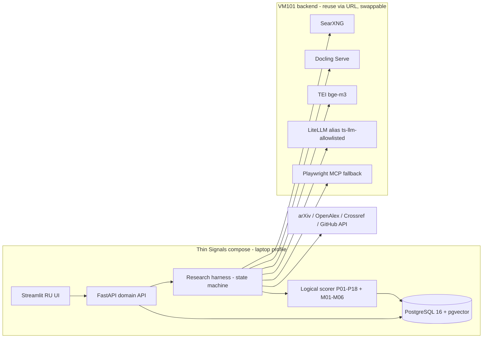

# Thin Signals — план 7.2 (harness-first, без обучения весов)

Revision: **7.2** · Дата: 2026-09-22 · Статус: **approved by operator 2026-09-19 (Cursor plan mode, Telegram @cursor_BACK_2_bot)**, восстановлен в репозиторий 2026-09-22 из рабочего контекста агента (файл плана Cursor на диск не записывался). Parent: 7.1. ADR: `docs/adr/ADR-009-HARNESS-FIRST-7.2.md`.

Уточнения из донорского пакета 2026-09-21 (`docs/lineage/handoff_2026-09-21/`) учтены в §6 и §7.

## 1. Что показало исследование (19.09, VM101)

- **Датасет.** `sources/100_слабых…xlsx` (B1:J102; колонки №, Технология, Область, Компании, Почему слабый сигнал, Стадия, Тренд упоминаний, Балл 3–7, Источники) содержит **только положительные примеры**. Разметка `data/dataset_patterns_100.json` — `analyst_proposal_unadjudicated`. Официальный датасет со скрытой разметкой (пост организаторов 19.09) на ВМ **не получен**; шаблон презентации — тоже.
- **ТЗ** (`sources/1. Газпромбанк.Тех.pdf`, стр. 2–5). Обязательны: алгоритм классификации/детекции ≥75–80 % с отчётом P/R/F1; интерпретируемость («математически **или логически**»); открытый запрос → ТОП-15; русский UI; карточка источника с уровнем доверия; модели только из списка (YandexGPT 5, Qwen3.6 35B-A3B / Qwen3 235B, GigaChat 2, gpt-4.1, gpt-5.6-luna) или локальные HF; **OpenRouter/автовыбор — только по согласованию**; репозиторий GitLab/GitHub; Docker; демо на ноутбуке; Streamlit допустим.
- **Бэкенд VM101** (`docker ps` 19.09): LiteLLM v1.101 :4000 (все chat-маршруты — OpenRouter; `embedding-local` → TEI bge-m3 :8080), SearXNG :28088, Docling Serve :5001, Playwright MCP :8931, gpt-researcher :8000 (RETRIEVER=searx, LLM через LiteLLM), Hermes 0.21 :8642, OpenViking :1933, AgentMemory :3111, PostgreSQL 16 — только внутри OpenMAIC. **Нет**: Neo4j, Procrastinate, S3, BERTopic.
- **LivingSet 7.1** сильна в предметной логике (P01–P18, D01–D06, PROCESSING_CONTRACT, HOLD/REJECT как валидные исходы), но тащит продуктовый `goal_control` с 18 TS-AG, tenants/OIDC/ACL, Neo4j, Procrastinate, S3, BERTopic, Refine/Cytoscape/Tiptap.

## 2. Переинтерпретация пункта «обучить модель»

Закрываем **логической моделью**: детерминированный скоринг на явных признаках; LLM — только извлекатель типизированных фактов из найденных источников; решение и уверенность считает код. P/R/F1 считается на отложенной части + корпусе контрпримеров в формате организаторов. Пороги калибруются на видимой разметке (подбор 1–2 чисел, зафиксированный в ADR, не обучение весов). Риск: жюри прогонит скрытую разметку автоматически — поэтому `ts eval` с адаптером их CSV/JSON обязателен (W2). Заявлять соответствие п. 7.1 ТЗ можно только после прогона с артефактами.

## 3. Архитектура 7.2

Контур: запрос → словарь механизма + негативные термины → поиск (SearXNG + прямые API) → snapshot + Docling → LLM-извлечение типизированных Claims/Events → дедуп событий (TEI + pgvector) → gates P01–P18 и контр-gates зрелости M01–M06 → скоринг с reason codes → реестр исключений → ТОП-15 → карточки RU.

## 4. Решения по развилкам

| Fork | 7.1 | 7.2 |
|---|---|---|
| `tz.classifier` | deferred optional | **decided `logical_scorer`** — обязателен; W5b удалён, метрики в W2 |
| `llm.provider` (new) | — | LiteLLM alias `ts-llm-allowlisted`: prod → Yandex Cloud AI Studio (YandexGPT 5 / Qwen3 235B) или GigaChat / gpt-4.1 direct; OpenRouter только dev, `model_id` логируется в каждом ответе. Ключи — operator gate |
| `backend.reuse` | open | **decided `extend_via_urls`**: свой compose (PG+pgvector, FastAPI, Streamlit); сервисы VM101 по URL из `.env`; laptop-профиль подменяет их |
| `graph.neo4j` | open | **closed `drop`** — граф как таблицы `nodes/edges` в PG (функция сохраняется, §6) |
| `sources.epo_cordis` | open | **`stub_unavailable`**; вместо: arXiv, OpenAlex, Crossref, Google Patents через SearXNG, GitHub REST |
| `ui.stack` | refine_antd | **`streamlit_ru`** (MINIMAL, разрешено ТЗ) |
| `goal.controller` | goal_control_in_pg (18 TS-AG) | сжат до 3 инвариантов: идемпотентный run; claim только с fragment+snapshot; process-статус ≠ научное решение. TS-AG-01…18 → lineage |
| `hosting.sourcecraft` | decided | остаётся канон + **обязательное зеркало GitHub** для сдачи (ТЗ п. 5) |
| `runtime.adapter` | hermes_primary | Hermes — dev-упряжь и опциональный глубокий countersearch; продуктовый harness — явный Python state machine |

## 5. Что убрано и что добавлено

Убрано: Neo4j/проекция (W3b, SC-08), BERTopic, S3, Procrastinate, OIDC/tenants/ACL (SC-10, TS-AG-06/12/13), Kafka/Redis/K8s, Refine/AntD/ECharts/Cytoscape/Tiptap, LoRA/QLoRA/GEPA, W5b sklearn, GoAll-церемония 11 шагов (остаётся OBSERVE→EXECUTE→VERIFY→INTEGRATE).

Добавлено: `docs/METHODOLOGY.md` (признаки F-P01…18 + контр-признаки M01–M06, формулы роста и порядок gates из v6.1, пороги, reason codes); `docs/EVAL.md` + `ts eval`; корпус контрпримеров `data/negatives_v1.json`; `data/source_trust.yaml`; реестр исключений; донорские skills в `donors/`; блокеры оператора в STATUS.

## 6. Replacement matrix (удаление компонента ≠ удаление функции)

| Убираем | Функция | Замена в 7.2 | Приёмочный сценарий |
|---|---|---|---|
| Neo4j | граф Document→Claim→Event→Technology с provenance, просмотр связей | таблицы `nodes`, `edges` в PG (relation, claim_ids, valid_from/to), запросы SQL/recursive CTE, в UI — список связей карточки | карточка показывает supports/contradicts/subtopic_of с источником и датой; dangling edge не сохраняется (FK) |
| S3 | immutable snapshots | каталог `snapshots/` (content-addressed по sha256) + таблица `documents.blob_ref`; бэкап tar | повторный fetch того же URL не создаёт второй snapshot; hash совпадает |
| OIDC / tenant | ограничение доступа к стенду и данным | один tenant; стенд за Caddy basic-auth / NetBird; API-ключ для UI→API; агенту продукта не даются operator-права backend | анонимный запрос к API получает 401; UI работает с ключом |
| Procrastinate | доставка run, retries, idempotency, cancel, recovery | таблица `runs` + `run_steps` в PG со статусами и `idempotency_key`; синхронный worker в API-процессе (BackgroundTasks) с lease/heartbeat; повтор шага по `input_hash` | повторный запуск того же запроса возвращает прежний run; отмена переводит в `cancelled`; падение процесса не теряет ledger |
| Refine/Cytoscape/Tiptap | карточки RU, evidence inspector, граф, отчёт | Streamlit pages: список, отчёт-страница, инспектор источников, таблица связей, реестр исключений | все поля ТЗ п. «Пример UI» присутствуют |
| BERTopic / Kleinberg / GEPA | discovery, aliases, singleton, временные признаки | словарь механизма + негативные термины (LLM-предложение → ручное утверждение), дедуп TEI+pgvector, `WATCHLIST_SINGLETON` из policy, окна 90 дней с `growth=null` при несопоставимости | singleton не теряется; growth не считается на неполном окне |
| sklearn LogisticRegression | «обучаемый компонент» по ТЗ | логическая модель (§2) с калиброванными порогами и P/R/F1 в формате организаторов | отчёт `reports/eval_<date>.md` с матрицей ошибок и версией правил |
| LangGraph / OpenCode dual adapters | понятная граница исполнителя | один Python harness; Hermes — опция через HTTP с allowlist | harness работает без Hermes |
| Auto-Goal daemon | контроль процесса | 3 инварианта в domain (§4) + LivingSet/STATUS для разработки | нет второго writable ledger |

## 7. Условия из KNOWN_GAPS (обязательны при адаптации)

1. `policy.py`: типы проверять до membership (`novelty=[]`, `critical_claims=[{}]` → контролируемый HOLD `invalid_contract`, не TypeError); агрегаты `evidence_events`/`independent_origins` брать из ledger, не из чисел LLM; порядок countersearch/branches согласовать с §6 METHODOLOGY и покрыть тестами.
2. Radar `validate_run.py` и POL `audit_evidence.py` — структурные; их rc=0 не разрешение публикации. Отдельный semantic gate: critical claims непусты, у каждого PASS есть evidence ref на прочитанный fragment, концы edges существуют.
3. GoalOps — контракты ролей, не scheduler; под одним контроллером.
4. Требование «обучение» закрывается только артефактами прогона eval, не названием `ts eval`.

## 8. Волны

- **W1 Contract 7.2 (22–23.09):** LivingSet 7.2, ADR-009, METHODOLOGY, donors/ с provenance, git init + push SourceCraft (LP-05), скелет `ts/` (pydantic-схемы, `ts/scoring/policy.py` с F03-fix + тесты, compose с pgvector, Alembic v1), импорт 100 строк как `seed_unverified`, alias `ts-llm-allowlisted`.
- **W2 Logical scorer + eval (23–24.09):** признаки, скоринг, reason codes; `negatives_v1.json` (~100 зрелых/стандартов/хайпа/шума с адъюдикацией); `ts eval`; отчёт P/R/F1. Gate ≥75 % на holdout — иначе пересмотр признаков.
- **W3 Live path (24–26.09):** harness state machine; коннекторы; Docling snapshot; LLM-извлечение; дедуп; countersearch зрелости; ТОП-15 с честным недобором.
- **W4 UI RU (26–27.09):** Streamlit по п. «Пример UI» ТЗ + счётчики.
- **W5 Release (27–28.09):** README+Docker laptop-тест, документация пайплайна, зеркало GitHub, слайды 7–11, `independent-verifier` на живом запросе. Буфер 28.09.
- **W6 Submit (29.09 до 23:59 МСК).**

## 9. Блокеры для оператора

Официальный датасет организаторов; шаблон презентации; ключи разрешённого LLM-провайдера (Yandex AI Studio / GigaChat / OpenAI direct); решение по согласованию OpenRouter с экспертами ГПБ (если ключей не будет).
