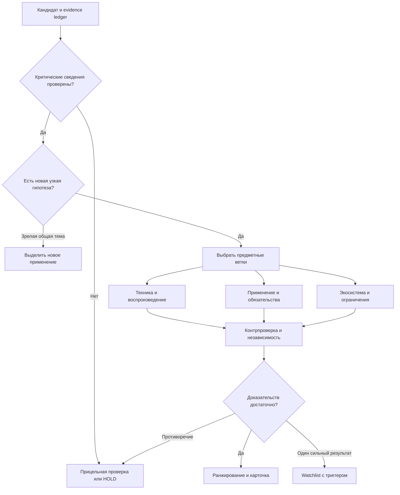

# Thin Signals — план 6.0: паттерны, доказательства и управляемый AI/harness

Дата среза: **17 сентября 2026**. Рабочий дедлайн: **29 сентября, 23:59 МСК**, по сообщению организатора. Версия 6.0 заменяет нормативную часть плана 5.0. Документ задаёт реализацию; он не является отчётом о уже развёрнутом сервисе.

## 1. Решение

**Строим систему выявления и проверки изменений в технологиях с неизменяемой базовой LLM.** Модель извлекает утверждения, предлагает гипотезы и следующие проверки. Код считает показатели, контролирует доказательства, даты, бюджет и переходы. Все решения сохраняются вместе с основанием. Fine-tuning, LoRA и QLoRA исключены из текущего критического пути.

Основной агентный исполнитель — **Hermes** за сменяемым адаптером. **OpenCode** сохраняем как альтернативу, **LangGraph** — как резервный способ оркестрации. Долговечность заданий обеспечивает PostgreSQL/Procrastinate, а не память чата агента. Предметное ядро — адаптированная методология **agispace-opportunity-radar**, отдельные правила **Product Opportunity Lab** и контракты **GoalOps**.

Вместо одной универсальной оценки вводим четыре независимых результата:

1. **Зарождение:** действительно ли появилось новое техническое содержание или применение.
2. **Доказанность:** какие утверждения подтверждены, кем и на какую дату.
3. **Динамика:** что изменилось в сопоставимом корпусе или стадии применения.
4. **Возможность:** зачем это банку/нам, какое действие имеет смысл проверить.

Процент на карточке не становится вероятностью успеха только потому, что его выдала LLM. Коммерческая привлекательность не делает зрелую технологию слабым сигналом, а отсутствие стартапа не обесценивает раннее исследование.

## 2. Что фактически исследовано

- Распакован предоставленный `Thin_Signals_Unified_Research_Kit_v1.0_2026-09-17.zip`: **1122 исходных файла**; все **1121 запись** его `checksums.sha256` совпали. Это целостность пакета, не проверка истинности содержащихся исследований.
- Изучены канонические документы проекта, готовый плагин radar, релевантные правила и код POL 1.2.1, workflow GoalOps и методика Trend Radar. Исторические версии проиндексированы; не утверждается, что каждое из повторяющихся вложений независимо перепроверено или запущено.
- Выполнен смысловой разбор **всех 100 строк XLSX**. Для каждой подготовлены паттерны, нужная ветка анализа, следующий проверяемый вопрос и ограничение. Это экспертная проектная разметка, пока без независимого согласования.
- Использованы ранее прочитанные расширенное ТЗ и изображение интерфейса. Перепроверены первичные документы arXiv, EPO OPS, CORDIS, GitHub Events, BERTopic и OpenCode.
- В XLSX **285 вхождений URL, 283 различных URL**. Они извлечены и сохранены; **не все 283 страницы независимо фактчекнуты**. Утверждения таблицы остаются входными заявлениями, а не автоматически подтверждёнными фактами.
- Этот аудит не доказывает доступ ко всей истории GPT/Hermes и не заменяет live-аудит сервера Agispace-backend. Сведения о сервере в архиве — исторические свидетельства; повторное использование конкретного сервиса требует проверки версии, здоровья, доступа и лицензии.

SHA256 входного ZIP: `1d6e74ff1b626bfb72d48adbfc75c24fbe315656bec8af0c469a6e66d381d110`.

## 3. Предикторы со скриншота: что именно перенимаем

Изображение показывает **сочетание разных каналов наблюдения**: научный результат → интеллектуальная собственность → финансирование → экосистема → спрос. Это позволяет вывести архитектурный паттерн, но не установить использованные авторами библиотеки, модели или алгоритм скоринга. Числа 124592/847/12 и 92%/78%/88% не сопровождаются корпусом или расчётом. В ТЗ изображение приведено как пример интерфейса.

| Предиктор | Единица наблюдения и вычисление | Проверка перед использованием | Типичный ложный сигнал |
|---|---|---|---|
| Всплеск патентов | Публично доступные патентные семейства выбранного типа; число новых семейств и заявителей по периодам | Семейства, юрисдикции, даты приоритета и публикации отдельно; одинаковый поисковый протокол; полнота выгрузки | Одна разработка опубликована в нескольких странах; публикационная задержка; пакетная загрузка |
| Рост arXiv | Работы и независимые исследовательские события, а не версии одного препринта; доля темы в фиксированном предметном корпусе | RU/EN aliases, прежние названия, категории, версии, журнальная версия той же работы, независимость команд | Рост всей базы arXiv, повторные версии, совпадение модного термина |
| Гранты ЕС | Присуждённый проект с ID, получателями, бюджетом, сроками и результатами | Решение о присуждении, роль организации, грант vs конкурс, общая сумма vs доля участника | Открытие конкурса считается выданным грантом; один консорциум — многими независимыми подтверждениями |
| Два seed-стартапа | Два независимых юрлица и закрытых раунда в одной узкой технической категории | Дата, стадия, валюта, round amount vs valuation, инвесторы, применяемый механизм | Две новости об одном раунде; бренд и дочерняя компания; переговоры вместо закрытия |
| «Миграция разработчиков» | Переход публичной активности между заранее заданными группами репозиториев; новые устойчивые внешние contributors | Стабильные repo/user IDs, bots/forks, прежняя активность, повторное участие, история покрытого периода | Stars и одноразовые PR; смена активности ошибочно названа сменой работы |
| Рост вакансий | Новые уникальные requisition IDs и доля релевантных ролей у фиксированного списка работодателей | Снимки вакансий, open/closed, нормализация дублей, география и роль, неизменная выборка компаний | Репост вакансии, evergreen-рекрутинг, расширение источников |

Практический доступ: [arXiv API](https://info.arxiv.org/help/api/user-manual.html) даёт структурированные метаданные; [EPO OPS](https://www.epo.org/en/searching-for-patents/data/web-services/ops) — интерфейс к патентным данным. В начале реализации проверяем учётные данные, квоты, покрытие и условия повторного использования, а не предполагаем неограниченный доступ.

[CORDIS](https://cordis.europa.eu/about/dataextractions) поддерживает выгрузки данных; доступные объём и формат зависят от режима. В частности, нельзя проектировать промышленный сбор на предположении, что публичная выдача автоматически даёт все результаты без ограничений.

У [GitHub Events API](https://docs.github.com/en/rest/activity/events) сейчас ограничение **до 300 событий и последние 30 дней**. Поэтому историю активности нужно сохранять самим или брать из проверенного исторического источника с известным покрытием. Отсутствие события за пределами доступной истории не равно отсутствию активности. Установление смены работодателя из этих данных не предусмотрено.

Вакансии собираем с доступных страниц работодателей/ATS с сохранением снимков; закрытые агрегаторы не объявляем гарантированным источником. Недоступный канал получает `unavailable`, а не нулевой рост.

### Три технологии на изображении

- **Квантовые медицинские сенсоры:** исследовать конкретный механизм и применение, например OPM-MEG, отдельно от клинической эффективности. Патентный всплеск и научный рост требуют независимых рядов; число публикаций не доказывает медицинскую пригодность.
- **Биоразлагаемые полимеры «третьего поколения»:** сначала нормализовать определение. Какие полимеры, в какой среде, за какое время, с какой минерализацией и экотоксичностью? Грант и два стартапа без технического результата подтверждают интерес, но не превосходство материала. Отдельных примеров этой области в данном XLSX нет.
- **Нейроморфный Edge AI:** общий класс давно существует. Достойный сигнал — узкая новая способность, design-in в EDA, серийный промышленный датчик или результат обучения на устройстве. Активность GitHub и вакансии поддерживают гипотезу формирования экосистемы, но не заменяют измерение качества и энергии.

Таким образом, перенимаем **многоканальное подтверждение конкретного изменения**, а не сами проценты или предположение о «секретном фреймворке».

## 4. Что удалось извлечь из всех 100 строк

### 4.1. Структура и ограничения

Таблица состоит из шести AI-ориентированных направлений: Edge и защита ИИ — по 16 записей; индустриальный ИИ, инфраструктура ИИ, роботы и финтех — по 17. Это относительно равномерно составленная подборка, а не случайная выборка мировой технологической активности.

Оценки: 7 — 15 строк, 6 — 28, 5 — 28, 4 — 22, 3 — 7. Таблица упорядочена по оценке. **ID, порядок строки, готовая оценка, словесная динамика и объяснение «почему слабый» нельзя использовать как независимые признаки для честного предсказания этой же оценки.** Это прямой риск утечки ответа.

В файле нет репрезентативного набора отрицательных примеров, исходных временных рядов или полностью определённого целевого класса. Поле «растёт» — утверждение составителя. Оно не заменяет динамику публикаций, патентов или использования.

### 4.2. Каталог из 18 механизмов

В `data/pattern_registry.json` определены механизмы, необходимые доказательства, контраргументы и ветки. В `data/dataset_patterns_100.csv` и JSON — привязка к каждой исходной строке.

| Код | Механизм | Характерные номера XLSX |
|---|---|---|
| P01 | Новый технический механизм | 49, 85, 89, 95, 97 |
| P02 | Порог эффективности, стоимости или ресурсов | 1, 7, 57, 84, 96 |
| P03 | Переход от опыта к применению | 17, 37, 81, 90 |
| P04 | Сближение раннего капитала | 2, 44, 61, 66 |
| P05 | Новый самостоятельный продуктовый слой | 2, 11, 36, 46, 75 |
| P06 | Новое применение зрелой технологии | 19, 43, 45, 72, 94 |
| P07 | Узкое место и дополняющая инфраструктура | 10, 13, 14, 34, 83 |
| P08 | Стандарт, совместимость, новые интерфейсы | 50, 51, 67, 69 |
| P09 | Новая угроза или нормативный стимул | 4, 15, 22, 76, 100 |
| P10 | Перенос вычислений и границ данных | 18, 24, 35, 82, 96 |
| P11 | Независимое исследовательское сближение | 76, 92, 97, 98 |
| P12 | Формирование экосистемы разработчиков | 45, 51, 69, 78, 88 |
| P13 | Разрыв между предметным прогрессом и вниманием | 89; общий мотив встречается шире |
| P14 | Новая модель транзакции, оплаты или риска | 14, 62, 67, 70 |
| P15 | Обязательство пользователя или внедренца | 12, 27, 31, 54, 71 |
| P16 | Соединение ранее раздельных технологий | 28, 63, 78, 79, 98 |
| P17 | Возвращение ранее неудавшегося направления | 8, 44, 84, 87 |
| P18 | Грант или публичная исследовательская программа | 55, 80 |

При выборе **главного** механизма каждой строки: новое применение зрелой технологии — **20**, новая угроза/нормативный стимул — **13**, самостоятельный продуктовый слой — **12**, порог эффективности — **10**. В совокупности это 55 из 100 записей нашей разметки. Этот результат объясняет, почему один детектор роста упоминаний не воспроизведёт полезную логику датасета.

Подсчёт относится к предложенной аналитической классификации, не является оценкой долей мирового рынка и не претендует на единственно возможную разметку. Вторичные метки многозначны. Например, P13 намеренно не проставлен всем строкам, где написано «почти не обсуждается»: слабое освещение само по себе не доказательство.

### 4.3. Иерархия, которую необходимо ввести

| Семейство | Строки | Что различать |
|---|---|---|
| Нейроморфные вычисления | 8, 45, 80 | Общий класс; включение в EDA; промышленный always-on сценарий |
| Аналоговый compute-in-memory | 44, 84 | Возрождение направления и показатели конкретных поставок |
| Орбитальный инференс | 18, 59 | Бортовое вычисление и более широкий проект орбитального ЦОД |
| Фотонное вычисление | 47, 60 | Ограниченный SWaP-сценарий и общий вычислительный класс |
| Федеративное обучение | 19, 43, 82 | Sovereign deployment, межбанковский AML, межзаводское применение |
| Инфраструктура агентов | 2, 50, 67, 69, 91 | Identity, полномочия, подпись трафика, оплата, settlement |
| Edge-оркестрация | 46, 56, 75 | Управление парком, распределённая сеть, маршрутизация отдельного запроса |

Это **кандидаты отношений**, не автоматические дубли. Две карточки можно сохранить, если различаются механизм, пользователь и доказанное изменение. Один и тот же раунд или прототип не должен повторно повышать их независимость. Разнообразие ТОП-15 достигается ограничением близких тем и объяснимой группировкой, а не удалением всех соседних применений.

### 4.4. Ошибки, которые наша система должна ловить

1. **№1:** смешаны размер раунда и оценка компании; отношение 570/215 само по себе не даёт «почти пятикратный рост оценки».
2. **№47 и №60:** для OLIX фигурируют $312M с разными месяцами — август и февраль. Нужен канонический event и первичный документ; не выбрать удобную дату автоматически.
3. **№12, №35, №59, №64:** план производства, будущее мероприятие, тесты 2027 и планируемый объём датасета нельзя учитывать как выполненные достижения на 17 сентября.
4. **№34:** контракт на питание ЦОД не делает реактор работающим. Финансовое обязательство и физическая готовность разделены.
5. **№43:** 10 млн синтетических транзакций в эксперименте не равны 10 млн реальных банковских операций.
6. **№76:** название обещает сертифицированную защиту, а объяснение описывает атаки и отсутствие зрелых защит. Выделяем подтверждённую угрозу и гипотезу решения отдельно.
7. **№85:** многие публикации об одном анонсе — одно исходное событие, а не широкое независимое подтверждение.
8. **№90:** «clinically ready», награда, доклинический результат и фактически проведённое испытание — разные стадии.
9. **№18 и №21:** разночтения сумм текста и slug ссылки — повод сверить страницу, но не основание считать slug истинным.
10. **№100:** новизна конкретной банковской миграции не равна новизне всей постквантовой криптографии.

Это найденные внутренние противоречия и задачи проверки. Там, где не прочитан первоисточник, документ не объявляет, какая сторона противоречия верна.

## 5. Как превращаем паттерны в сбор и обработку

### 5.1. Контракт паттерна

Каждое правило содержит `pattern_id`, применимые отрасли, механизм, примеры и контрпримеры, извлекаемые события, нужные поля, источники, проверки, критерий результата, следующий шаг, срок пересмотра и версию. Оно не является длинным промптом «найди что-нибудь интересное».

Например, **P17 Revival**:

- обнаружить прежний провал/закрытие и новый опыт, раунд или поставку;
- выяснить, какой прежний барьер изменился: yield, ADC/DAC overhead, стоимость, доступность данных, энергопотребление;
- если изменились только инвесторы и формулировки — не подтверждать техническое возрождение;
- если есть измеренный новый результат — отправить в PERFORMANCE и MATURITY;
- если критические сведения закрыты — HOLD с триггером «публикация benchmark/первые поставки».

### 5.2. Контракт отдельного утверждения

Минимальные поля: `claim_id`, `subject`, `predicate`, `object_or_value`, `unit`, `scope`, `kind`, `status`, `critical`, `evidence_for`, `evidence_against`, `event_id`, `origin_group_id`, `available_at`, `event_at`, `planned_for`, `fetched_at`, `valid_as_of`.

- `kind`: факт источника, заявление поставщика, аналитический вывод, гипотеза, прогноз.
- `status`: verified/supported/unknown/disputed/refuted. Достаточность подтверждения зависит от утверждения: пресс-релиз подтверждает, что компания заявила показатель; сам показатель может остаться `reported`.
- Сумма раунда, valuation, грант, revenue, контракт, мощность, отгрузки и будущая мощность — отдельные типы значений.
- Источник хранит snapshot/hash, URL, название, язык, фрагмент, его позиции и доступность. Ссылка без прочитанного фрагмента не делает claim проверенным.
- Дата публикации документа, дата события, дата первого наблюдения нами и плановая дата исполнения не сливаются. Нынешняя версия обновляемой страницы не доказывает, что текст был известен в прошлом.

### 5.3. Стадии

| Этап | Что выполняется | Обязательный выход |
|---|---|---|
| 0. Scope | Направление, временной срез, география, задача пользователя, бюджет | Версионированный research request |
| 1. Discovery | Расширение терминов, поиск первичных источников, сбор кандидатов | Список документов и причины находки |
| 2. Ingest | Snapshot, hash, метаданные, парсинг HTML/PDF/XLSX, язык | Document/chunk с provenance |
| 3. Normalize | Организации, технологии, родитель/подтема, DOI/arXiv/family/round IDs | Canonical entities и события |
| 4. Extract | Типизированные claims и связи с цитатами | Evidence ledger, конфликты, неизвестное |
| 5. Route | Выбор механизмов P01–P18; ранние проверки критических зависимостей | План релевантных веток |
| 6. Verify | Проверка механизма, эффективности, внедрения, капитала и иных нужных веток | Ответы на конкретные критические вопросы |
| 7. Countersearch | Старые аналоги, отрицательные результаты, зрелые решения, повторы | Аргументы за и против новизны |
| 8. Measure | Допустимые временные ряды и зарегистрированные переходы стадий | Feature snapshot с missingness/coverage |
| 9. Decide | Допуск, watchlist, HOLD, исключение или уточнение подтемы | Версионированное решение и основание |
| 10. Rank/report | ТОП до 15 подтверждённых ранних тем, отдельные новые наблюдения, применение банку | Карточки, граф, отчёт, журнал решения |
| 11. Monitor | Новые события, противоречия, истечение актуальности, re-entry trigger | Пересмотр карточки, история версий |

Материал из веба остаётся данными; содержащиеся в нём инструкции не меняют права инструментов, системные правила или схему анализа. Любая предлагаемая агентом новая стратегия становится кандидатом конфигурации, проходит проверку и получает новую версию. Runtime не устанавливает произвольные плагины из найденных страниц.

## 6. Разветвлённая логика

Не каждый кандидат проходит все ветки. Для лабораторной e-skin нет обязательного seed-раунда; для новой закупочной платформы arXiv не обязателен. Для каждого пропуска фиксируем: нерелевантно, уже подтверждено или отложено до конкретного решения.

**Приоритет переходов:** проверка доступности и критических опровержений → unresolved claims → зрелость → выбранные ветки → контрпроверка → допуск → ранжирование. Дедлайн не может превратить UNKNOWN в PASS или обойти подтверждённое опровержение. Отрицательное слабое сообщение сначала проверяется; оно не автоматически убивает направление.

Начальная политика допуска в основной список: конкретное новое содержание, ранняя стадия, минимум три самостоятельных события и две подтверждённые группы происхождения, выполненные критические проверки и подтверждённое изменение. **Это инженерная гипотеза допуска, а не научно установленная универсальная граница.** Меняем её только через версию и оценку результатов.

Единственный сильный новый результат обязательно сохраняется в **watchlist singleton**. Его нельзя потерять как шум HDBSCAN, но нельзя и назвать широким независимым трендом. Если подтверждено 9 подходящих тем, показываем 9 и причину; оставшиеся места не заполняем выдумками.

После двух поисковых волн без изменения критических сведений: сменить метод, уточнить гипотезу или HOLD с условием возврата. Не запускать бесконечное повторение похожих запросов.

## 7. Что и как считаем

**Discovery corpus** и **measurement cohort** хранятся отдельно. Первый меняется при поиске; второй фиксирует запрос, источник, критерии включения, даты, полноту страниц и версию сборщика. Результаты top-k поиска подходят для discovery, но не для доли технологии во всей отрасли.

Для сопоставимого источника:

`p = (n + 0.5) / (N + 1)`;

`g = log2(p_recent / p_previous)`.

`n` — независимые события темы, `N` — события направления в том же корпусе. Сглаживание уменьшает проблему нуля, но не доказывает статистическую значимость. Показываем исходные n/N, оба периода, интервалы неопределённости и ограничения независимости. При большом числе одновременно проверяемых тем отдельно контролируем множественные сравнения; один высокий z-score не объявляем открытием.

Для первой реализации выбираем **два непересекающихся окна равной длительности по 90 завершённых дней**, заканчивающиеся до среза, плюс более длинный фон по доступности. Календарные месяцы и кварталы показываем отдельно. На 17 сентября Q3 ещё не завершён: возможен явно помеченный quarter-to-date при сопоставимом фоне, но не сравнение неполного Q3 с полным кварталом без поправки.

Если корпус неполон или протокол менялся, `growth = null` и причина видны. Не подставляем 0 и не нормализуем скрыто оставшиеся веса. Подлинно новое событие всё равно может быть полезно через качественную ветку перехода; для него не рисуем вымышленный численный рост.

**Технический выигрыш:** baseline, аппаратная конфигурация, датасет, precision/quality, latency/throughput/energy, весь системный контур, воспроизводимость. Показатели из разных условий не усредняются как сопоставимые.

**Капитал:** число независимых команд и закрытых событий; сравнение раундов отдельно от valuations. Размер денег — поддерживающий признак, не автоматический балл ранней стадии.

**Граф:** отдельные Document → Claim → Event → Technology/Application/Organization, а также `supports`, `contradicts`, `subtopic_of`, `implements`, `funded_by`, `announces`, `pilots`, `depends_on`. Подтверждённый поставщик и потенциально способный поставщик имеют разные отношения. Каждый значимый edge имеет источник и дату; similarity не превращается в факт сотрудничества.

**Ранжирование:** сначала gates, затем версионированная сортировка по доказанности нового содержания, подтверждённому изменению стадии/механизма, независимости, релевантности запросу и доступной динамике. Компоненты видимы. Для одинакового профиля допускаем экспериментальный emergence index, но не смешиваем качественный singleton и богатый библиометрический ряд в одну псевдовероятность. Opportunity/bank relevance остаётся отдельной осью.

## 8. BERTopic, bursts, граф и выбранный стек

**BERTopic и burst detection не альтернативы одной задачи.** BERTopic группирует тексты и помогает описывать темы; detector ищет изменение в последовательности наблюдений. По [документации BERTopic](https://maartengr.github.io/BERTopic/getting_started/topicsovertime/topicsovertime.html), `topics_over_time` использует общую тематическую модель. Для честного исторического эксперимента её нельзя обучать на будущих документах относительно cutoff. Упомянутое там fine-tuning представлений тем не означает LoRA базовой LLM.

Выбор: **BERTopic для пакетного discovery и обзорных карт + собственные прозрачные признаки динамики на NumPy/SciPy**. Не делаем кластеризацию обязательным входным фильтром. Не добавляем отдельный «Burst Trend» как неидентифицированную зависимость. Kleinberg/change-point/другие детекторы — последующие сравнительные эксперименты на тех же событиях, если простая версия даёт измеренный пропуск.

| Слой | Выбор сейчас | Роль и граница |
|---|---|---|
| API/domain | Python 3.12, FastAPI, Pydantic, SQLAlchemy/Alembic | Typed contracts, запросы, run state; соответствует минимуму Python из ТЗ |
| Истина/история | PostgreSQL + pgvector, полнотекстовый поиск | Документы, claims, events, runs, версии, vectors; tenant/RBAC |
| Файлы | Уже доступное S3-совместимое хранилище или защищённый файловый backend через общий интерфейс | Raw snapshots, immutable hashes, экспорт; не внедрять второй object store без нужды |
| Граф | Neo4j как восстановимая проекция из PG через outbox | Связи и обход; PostgreSQL сохраняет исходные facts и edges |
| Извлечение | HTTPX, feedparser, Trafilatura, PyMuPDF; browser только по необходимости | Не запускать тяжёлый браузер для каждого API/HTML |
| Embeddings | BGE-M3, без дообучения; версия и размерность фиксированы | RU/EN semantic retrieval; оценить на нашей контрольной выборке |
| Группировка | BERTopic | Пакетные кандидаты и aliases; singleton-путь независим |
| Численные признаки | NumPy/SciPy, детерминированные функции | Рост, нормировки, missingness; ни один процент не берётся из LLM |
| Агентный исполнитель | Hermes + фиксированные предметные инструкции | Разбор, планирование исследований, синтез; ограниченные инструменты |
| Смена исполнителя | RuntimeAdapter; OpenCode кандидат, LangGraph резерв | Общие request/result/cancel/budget/artifact контракты |
| Долгие задания | Procrastinate + PostgreSQL | Retries, идемпотентные шаги, timeout, checkpoint; не вечный agent loop |
| LLM | Один разрешённый основный и один fallback через явную конфигурацию | Согласованный whitelist ТЗ; фиксировать provider/model/version; исключить скрытый auto-routing |
| UI | React + Refine + Ant Design | Таблицы, фильтры, drilldown, RBAC; готовая административная основа |
| Визуализация | Apache ECharts + Cytoscape.js | Временные ряды и граф фактов из API |
| Редактор отчёта | Tiptap | Canvas-подобный документ из проверенных карточек; ссылки и версии |
| Эксплуатация | Docker Compose, reverse proxy, OIDC, метрики/логи и резервные копии | Один развёртываемый контур; recovery test до сдачи |

Точные версии зависимостей фиксируются lockfile после проверки совместимости в целевом репозитории. Этот документ не подтверждает наличие конкретных сервисов на текущем сервере. Не добавляем Redis, Kafka, Kubernetes, отдельную векторную БД, Temporal и ещё одну систему agent orchestration до появления конкретного ограничения.

**OpenCode умеет SKILL.md и агентные роли**, что подтверждено его [skills](https://opencode.ai/docs/skills/) и [agents](https://opencode.ai/docs/agents/) документацией. Но доступность скиллов не доказывает более качественный поиск сигналов или устойчивость задач. Смена Hermes разрешается после одинаковых сценариев: ограничения инструментов, чтение нужного skill, валидный JSON, сохранение артефактов, остановка, восстановление и стоимость. Если текущего Hermes-интеграционного кода фактически нет, этот тест проводится до выбора первого adapter, а не имитируется «уже готовая миграция».

## 9. Что перенимаем из архива

| Наработка | Решение | Конкретная адаптация |
|---|---|---|
| agispace-opportunity-radar 0.1.1 | Основной методический донор; использовать полный набор инструкций для исследовательской работы | Перенести ledger и разделение signal/evidence/opportunity; выделить signal states отдельно от investment/build decisions |
| `signals.md`, `evidence.md` | Переиспользовать смысловые правила | Уточнить профили допуска, event dedup, даты, независимость; запретить заполнение missing нейтральным баллом |
| `run.template.json` | Образец структуры | Это шаблон, а не JSON Schema; сделать формальную схему и межобъектные проверки |
| `validate_run.py` | Вспомогательная структурная проверка | До использования как gate исправить отсутствие обязательных критических claims, evidence у PASS и проверки концов edges |
| Product Opportunity Lab 1.2.1 | Условные аналитические ветки | CONTINUE/SKIP/JUMP/EXIT, проверка зависимостей, negative evidence, loop breakers; коммерческие модули только по задаче |
| POL `simulate_routes.py` | Dev-пример, не production routing | Изменить приоритет критических отказов; заменить голый `hard_fail` доказанным scoped finding |
| GoalOps | Контракты разработки и сопровождения | capability probe, goal/acceptance, task DAG, ADR, evidence manifest, stop gates; не запускать полный workflow для каждой статьи |
| Agispace Trend Radar Package | Методика корпуса и карточки | Reuse source/cohort/version/coverage contracts; пересмотреть правило, отправляющее любую небиблиометрическую тему только в watchlist |
| Science/Supply Radar reconstruction | Донор понятий supply chain и узких мест | Считать восстановленной заметкой, не оригинальным исполняемым скиллом; связи требуются с доказательствами |
| OpenResearch audit / Knowledge Factory | Идеи knowledge intake и отдельный R&D-контур | Не заменять ими evidence ledger; создавать спецификации новых проверок только после оценки |
| NeuroEvolution/WavePack/EvolutionWatch и исторические версии | Отложить | Сохранить происхождение и отдельные полезные gates; не подключать все пакеты одновременно |

### Проверенные дефекты границ автоматизации

Выполнены минимальные воспроизводимые контрпримеры; результат лежит в `data/donor_checks.json`.

- Radar validator возвращает **пустой список ошибок** для `PRODUCTION BUILD`, `R4`, произвольного PASS gate без источников и пустого списка claims. Предупреждение о пустом ledger есть. Скрипт честно заявляет, что он структурный, но его `PASS` нельзя использовать как production approval.
- Тот же валидатор принимает `depends_on` между несуществующими сущностями: таблицы entities и проверки ссылочной целостности в этом контракте нет.
- В POL simulator `decision_deadline + info_improvement_unavailable` возвращает `PROVISIONAL_OPTION_PRESERVING_DECISION` **раньше проверки `hard_fail`**. Это дефект примера control-flow, а не доказательство некорректности всей методологии POL.

Итог слияния: **предметная методология radar + адаптивные ветки POL + дисциплина изменений GoalOps + корпусная методика Trend Radar + исполняемые gates нашего сервиса**. Готового production-сервиса в этих документах не обнаружено; наличие SDK/skill/manifest не означает, что коллекторы, storage и API уже реализованы.

## 10. Fine-tuning, обучение и честная проверка качества

Гипотеза пользователя хорошо обоснована **для исходной инженерной стратегии**: 100 отобранных описаний без надёжных отрицательных примеров и рядов полезнее как источник правил и тестовых сценариев, чем как достаточный материал для обучения универсального детектора. Но превосходство harness над fine-tuning на нашей задаче ещё не измерено; его нельзя объявить установленным фактом.

Основной продукт использует frozen LLM, retrieved evidence, типизированное извлечение, специализированные инструкции, проверяемую арифметику и ветвление. Fine-tuning рассматриваем после появления корпуса реальных ошибок и независимой оценки, когда видна повторяющаяся задача, которую не решает изменение контекста/инструментов/схемы. Бюджетная экономия, стабильность формата или узкая классификация могут стать будущей причиной обучения; красивый demo-score — нет.

**Сохраняется конфликт с буквальным ТЗ:** расширенное описание требует обучения модели на предоставленных данных и метрик precision/recall/F1. Полностью безобучающийся pipeline нельзя автоматически объявить соответствующим этому пункту. Prompt engineering не переименовываем в обучение модели.

Поэтому выделяем **необязательный для работы ядра, но предусмотренный для конкурсного соответствия классификатор на признаках**: LogisticRegression/scikit-learn после согласования target и получения размеченных отрицательных/пограничных примеров. Это не fine-tuning LLM. Он должен выполнять реальную измеримую задачу классификации/ранжирования, а не существовать ради формальной галочки. Если организаторы подтвердят допустимость frozen ML+harness, этот адаптер исключается из обязательной сдачи. До подтверждения пункт числится открытым риском соответствия.

Теперь все 100 записей использованы при проектировании паттернов. **Ни одну их часть нельзя честно назвать нетронутым holdout этого дизайна.** Проверка на них — regression/design set. Для внешней оценки собираем новый набор, например 40–60 кандидатов, с зрелыми технологиями, репостами, неудачными опытами, будущими анонсами и действительно ранними темами. Такой объём — стартовое ограниченное исследование, не доказательство промышленной точности 80%.

Два независимых разметчика согласуют критерии; спорные примеры сохраняются. Разделение по semantic family/origin/event, чтобы №8/45/80 или один раунд из двух карточек не оказались по разные стороны теста. Для честного backtest сохраняется информация, доступная на cutoff; современная интерпретация старого текста маркируется как ретроспективная и не выдаётся за историческое обнаружение.

Сравниваем на одинаковом бюджете и источниках: A — prompt-only; B — retrieval + extractor; C — B + patterns + evidence gates + countersearch. Метрики: precision@15 по экспертной рубрике, recall относительно ограниченного размеченного пула, macro-F1 для определённого класса, доля неподтверждённых существенных claims, число ложных дублей, temporal leakage, стоимость и время. Recall всех неизвестных мировых трендов измерить этим тестом нельзя. Abstention/HOLD показываем вместе с coverage и не скрываем исключением неудобных примеров.

GEPA/prompt optimization — только отдельный offline-кандидат после появления разметки и неизменяемого теста. Самообновление production prompts по собственным ответам запрещено: сначала кандидат → evaluation → review → новая версия → rollback point.

## 11. Интерфейс аналитика

**Главный экран:** направление, временной срез, фильтры; затем подтверждённые ранние темы и отдельная вкладка наблюдений. Вместо одного AI% — «новое содержание», «доказательства», «изменение», «ограничения». Счётчики различают документы, уникальные события, кандидатов, проверенные сигналы; слова «источник» и «аномалия» получают точное определение.

**Карточка:** что изменилось и когда; какую проблему решает; преимущество с условиями; пример; stage; график с n/N и покрытием; cited claims; отрицательные данные; компании и связи; что проверить следующим; история пересмотров. Нажатие на предиктор открывает его расчёт, исходные события и протокол.

**Граф:** переключаемые слои технология/компания/исследование/патент/финансирование; ограниченная глубина, видимые типы связей и дата актуальности. Пунктир для гипотезы и явно помеченная неподтверждённость, а не визуальное уравнивание с фактом.

**Canvas-подобный отчёт:** Tiptap-документ с карточками, диаграммами ECharts и источниками. LLM предлагает текст только из выбранного evidence bundle. Числа и серии диаграмм приходят из валидированного JSON/API; произвольный генерируемый JS не исполняется. Отчёт можно редактировать и экспортировать; ручная правка не изменяет исходный факт без отдельного действия.

Отдельный «скилл рисования» полезен для выбора представления, но не обязателен для воспроизводимого продукта. Визуализация должна жить в UI и его контракте данных. Так смена Hermes/OpenCode не сломает графики и отчёты.

## 12. Реализация до 29 сентября

Оценка предполагает примерно трёх параллельно работающих исполнителей: data/backend, AI/аналитика, frontend/infra, с участием предметного эксперта. Если работает один человек, весь этот объём до срока не подтверждён; сокращаем число одновременно подключаемых источников и декоративные функции, сохраняя качество хранения, доказательств и основных путей. «Production foundation» не означает, что сроком отменены тесты восстановления и реальные ограничения команды.

| Даты | Результат | Проверяемая приёмка |
|---|---|---|
| 17–18 сентября | Freeze контрактов v6; capability audit сервера; model/source access; разрешение неоднозначности обучения | requirements, ADR, доступы и точные версии; никаких предположений «уже стоит» |
| 18–20 | PG/pgvector, raw store, jobs, snapshots, ledger, entity/event dedup; 100-row import | Идемпотентный повтор, сохранение дат, conflicts, parent/child; исходная оценка не feature |
| 20–22 | arXiv/библиография, первичные сайты; патентный и CORDIS-коннектор при проверенном доступе; первый Hermes adapter | Один полный запрос извне 100 строк с цитатами; отсутствие источника не даёт нулевой признак |
| 21–23 | Ветки механизмов, контрпроверка, score explanations; PG→Neo4j; граф и поиск | Сценарии future/duplicate/mature/singleton/contradiction и восстановление projection |
| 23–24 | UI Refine, карточка и inspector предиктора, watchlist, первые отчёты | Весь путь человека от запроса до доказательства на русском |
| 24–25 | Независимый evaluation set, ablation; feature classifier при требовании ТЗ; лимиты стоимости | Честные метрики с denominator, coverage и ошибками; нет обещанного заранее 80% |
| 26 | Feature freeze; резервные копии, restore, retry/cancel, ACL, модельный whitelist | Release candidate проходит эксплуатационные и предметные gates |
| 27–28 | Стенд для жюри, README, исходники, отчёт, презентация и первая загрузка | Проверить доступ снаружи; обязательные слайды 7–11 из оригинального шаблона |
| 29 | Исправления блокирующих проблем и окончательная сдача до 23:59 МСК | Проверка загруженного комплекта; никаких крупных миграций orchestration |

GitHub migration/hiring — подключаемые ветки с реальным накоплением истории с начала эксплуатации. Если до конкурса недостаточно истории, показываем текущие наблюдения и отсутствие измеримого роста. Не изображаем задним числом квартальный ряд. Граф, vector search, run history, полноценные карточки и provenance входят с первой версии.

## 13. Живой план и контроль эволюции

В репозитории: `CONCEPT.md`, `ARCHITECTURE.md`, `requirements.yaml`, `plan.yaml`, `patterns/registry.json`, `schemas/`, `skills.lock`, `models.yaml`, `sources.yaml`, `docs/adr/`, `STATUS.md`, `eval/manifest.json`.

Любое изменение метода в одном PR обновляет код, contract/schema, затронутые patterns, ADR и сценарий проверки. В задаче есть requirement IDs, зависимости, owner, acceptance, evidence и статус. Release manifest связывает commit, prompt/skill hashes, model ID, source/corpus version, calibration и schema version. Старые reports остаются воспроизводимыми снимками; новая методика не молча переписывает прежние результаты.

Состояния работы: proposed → implemented → tested → accepted. «Обсудили в чате» не равно implemented; «есть скрипт» не равно accepted. CI проверяет структурные связи реестров; содержательное соответствие подтверждает reviewer. Автоматические gates не удостоверяют истину научных утверждений сами по себе.

## 14. Что находится в приложенном пакете

- `data/dataset_patterns_100.csv` / `.json` — все 100 строк с исходным содержанием, ссылками, паттернами и конкретными проверками.
- `data/pattern_registry.json` — 18 механизмов; это проектные правила, не сгенерированная «истина».
- `data/predictor_registry.json` — шесть предикторов с полями, вычислением и доступностью.
- `data/mapping_summary.json`, `data/archive_integrity.json`, `data/donor_checks.json` — воспроизводимые итоги анализа и аудита.
- `reference/policy.py`, `reference/test_policy.py` — компактный исполняемый пример приоритета gates и сопоставимости рядов. **15 сценариев прошли**. Это reference implementation, не deployed backend и не полная schema validation.
- `docs/PROCESSING_CONTRACT.md`, `docs/CURSOR_HANDOFF.md`, `docs/ARCHIVE_REUSE.md` — контракты интеграции и следующие задачи.
- Копия этого плана и manifest файлов.

Утверждённое направление: harness-first, frozen LLM, явные паттерны, накопление evidence graph и векторов, воспроизводимые измерения. Научную и коммерческую состоятельность каждого найденного сигнала система должна доказывать отдельно; её нельзя заменить ни размером библиотеки скиллов, ни обучением на сотне готовых ответов.
